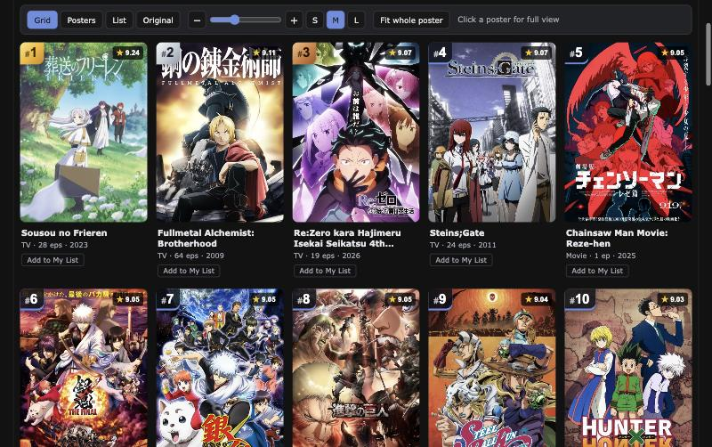
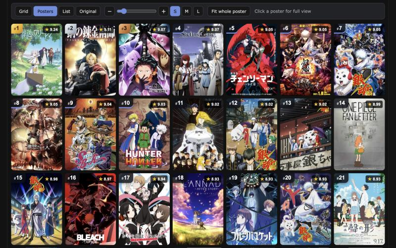
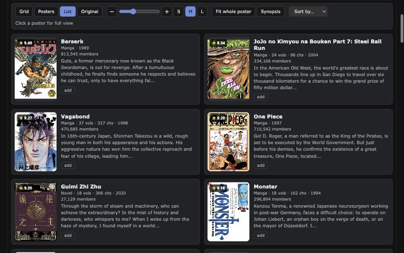
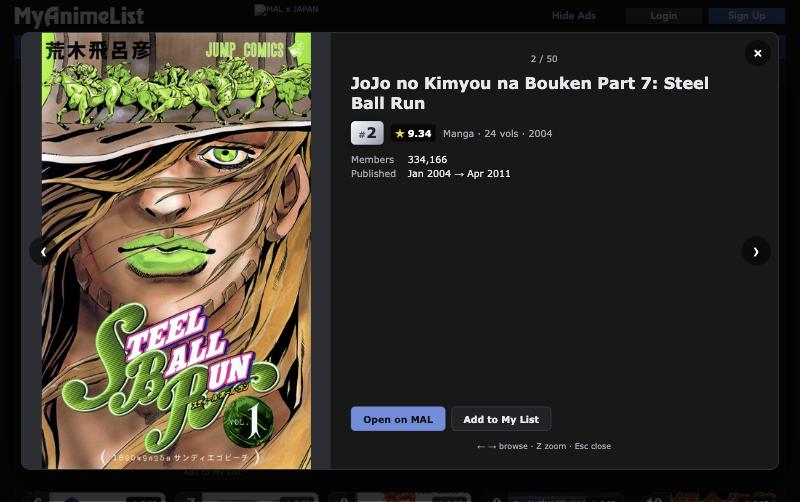

# MAL Visual Refresh

A Chrome extension that changes MyAnimeList's search results and top lists from small-thumbnail tables into **poster-first grids**. It's built for people who recognise a show by its poster before they read its title.

> **Unofficial.** This is an independent, fan-made project. It is not affiliated with, endorsed by, or connected to MyAnimeList. MAL still handles search, login, your lists and all navigation; this extension only changes how the results look in your own browser.



## Features

- **Sharp posters.** MAL's lists only show 50×70 thumbnails. The extension shows MAL's own full-size artwork instead (up to 425×600, from the same image server MAL uses). If an image fails to load, it falls back to the original thumbnail, then to a "No image" placeholder.
- **Four layouts**, one click apart:
  - **Grid**: poster cards with title, type, count and year
  - **Posters**: a wall of posters only; hover or focus a poster to see its title
  - **List**: poster plus synopsis, two columns on wide screens
  - **Original**: MAL's own table, exactly as it was
- **Poster size control.** A slider, −/+ buttons and S / M / L presets (110–360 px).
- **Full view.** Click any poster to see a large poster with everything MAL lists for that entry: rank, score, type, episodes or volumes/chapters, rating, members, aired/published dates and synopsis.
  - **← / →** step through the results
  - **Z** (or clicking the poster) shows the poster alone at full height
  - **Esc** closes it
- **Rank medals on top lists.** #1–3 get gold, silver and bronze tabs; #4–10 are highlighted.
- **Fit or fill.** Show the whole poster, or fill the frame (MAL posters are nearly the frame's shape, so very little is cropped).
- **Your list stays MAL's.** The card's *add* / *Add to My List* button opens MAL's own add-to-list dialog.
- **Sorting** on search pages goes to MAL's own sort links, so MAL still does the sorting.
- **Follows MAL's dark mode**, works with the keyboard, and respects reduced-motion settings.
- **Safe to switch off.** MAL's original table is never deleted, only hidden. If a page looks unfamiliar, the extension leaves it untouched.

| Posters layout | List layout (manga search) | Full view |
| --- | --- | --- |
|  |  |  |

## Supported pages

Each page only shows the fields MAL itself prints there. A missing value (`?`, `-`, `N/A`) is left out, never shown as 0.

| Page | URL | Shown on cards and in full view |
| --- | --- | --- |
| Anime search | `myanimelist.net/anime.php` | score, type, episodes, year, members, rating, synopsis |
| Manga search | `myanimelist.net/manga.php` | score, type, volumes, chapters, year, members, synopsis |
| Top anime (every tab) | `myanimelist.net/topanime.php` | rank, score, type, episodes, aired dates, members |
| Top manga (every tab) | `myanimelist.net/topmanga.php` | rank, score, type, volumes, published dates, members |

Keyword searches show fewer columns than browsing (only Type / Eps. / Score), so cards show fewer details there.

## Install

**Coming soon to the Chrome Web Store.** Once it's listed, you'll be able to install it in one click from there, and Chrome will keep it up to date automatically.

Want to try it before then, or test changes? See [Run from source](#run-from-source-testing).

## How to use

- **Toolbar** (above the results): pick a layout, drag the size slider, toggle *Fit whole poster* or *Synopsis*, or choose *Sort by…*. Your choices are saved and apply to every supported page and every open tab.
- **Click a poster** for full view. Click the **title** to open the entry on MAL; Ctrl/⌘-click opens it in a new tab as usual.
- **Extension popup** (toolbar icon): turn it on or off, change layout or poster fit, or *Reset to defaults*.
- **Need something only the old table has** (like MAL's hover popups)? Click **Original**.

## Privacy

- The only thing stored is your display preferences, in Chrome's extension storage on your own device.
- No analytics, tracking, accounts or servers. The extension sends nothing anywhere.
- The only network requests it adds are the larger poster images, loaded from MAL's own image server (`cdn.myanimelist.net`), the same images MAL shows on its anime and manga pages.
- Permissions: `storage` (for your preferences) and access to the four MAL pages listed above. Nothing else.

## Known limitations

- **Signed-in pages haven't been fully checked yet.** Everything was verified signed out. The list button copies whatever MAL shows (e.g. your watch status), but other signed-in controls may not appear on cards yet.
- The top lists' **Your Score** column isn't on cards. Use *Original* to see or edit it.
- MAL's **hover info popups** aren't recreated. Use *Original*.
- **No-results pages** and any page MAL changes unexpectedly stay in MAL's normal view. Open the DevTools console to see a `[MAL Visual Refresh]` line explaining why.
- **Chrome only** for now. Firefox support is planned.

## Development

### Run from source (testing)

Use this to try unreleased changes or to test the extension locally. You need [Node.js](https://nodejs.org/) 18 or newer.

```bash
git clone https://github.com/EDAMGHY/mal-visual-refresh.git
```

```bash
cd mal-visual-refresh && npm install && npm run build
```

Then in Chrome:

1. Open `chrome://extensions`.
2. Turn on **Developer mode** (top right).
3. Click **Load unpacked** and select the `dist/` folder.
4. Open a MyAnimeList search or top list.

**After a change:** run `npm run build` (or keep `npm run watch` running), click the reload icon on the extension's card in `chrome://extensions`, then refresh the MAL tab.

If you also have the store version installed, turn it off while testing, so the two versions don't both change the page.

### Commands

```bash
npm run build       # one-off build into dist/
npm run watch       # rebuild on save
npm test            # parser, poster URL, settings and storage tests (Vitest + jsdom)
npm run typecheck   # strict TypeScript
```

Project layout:

```
public/manifest.json        Manifest V3: storage permission, content script on 4 MAL pages
src/adapters/               Read MAL's page into plain data (never changes the page)
  routes.ts                 Which page is this, and which parser handles it
  search.ts                 anime.php / manga.php tables (columns mapped by header name)
  top.ts                    topanime.php / topmanga.php ranking tables
  posters.ts                Thumbnail URL → full / large image URLs
src/ui/                     Cards, toolbar, full view (built with textContent, no innerHTML)
src/content/lifecycle.ts    Mount next to MAL's table, hide it, restore it, recover from errors
src/settings/               Validated settings in chrome.storage.local
src/styles/content.css      All styles, scoped to #malvr-root / #malvr-full
tests/                      Vitest suites + sanitized fixtures captured from the real pages
scripts/                    esbuild build and the fixture capture helper
```

Fixtures in `tests/fixtures/` are trimmed copies of the real pages, captured while signed out. To refresh one after MAL changes its markup:

```bash
node scripts/capture-fixture.mjs '<page url>' '<table selector>' <row numbers> <output file>
```

For a write-up of the design decisions, MAL's page structure (verified 1 Nov 2026), and how everything was tested, see the [project report](docs/REPORT.md).

## Contributing

Issues and pull requests are welcome. When reporting a problem, include:
- the extension version
- your Chrome version
- the MAL URL
- whether you were signed in
- what you expected and what happened

If MAL changed its markup, a fresh fixture showing the change helps most.

## License

[MIT](LICENSE). MyAnimeList and all anime and manga artwork belong to their respective owners. The screenshots in this repository show third-party poster art for illustration only.
